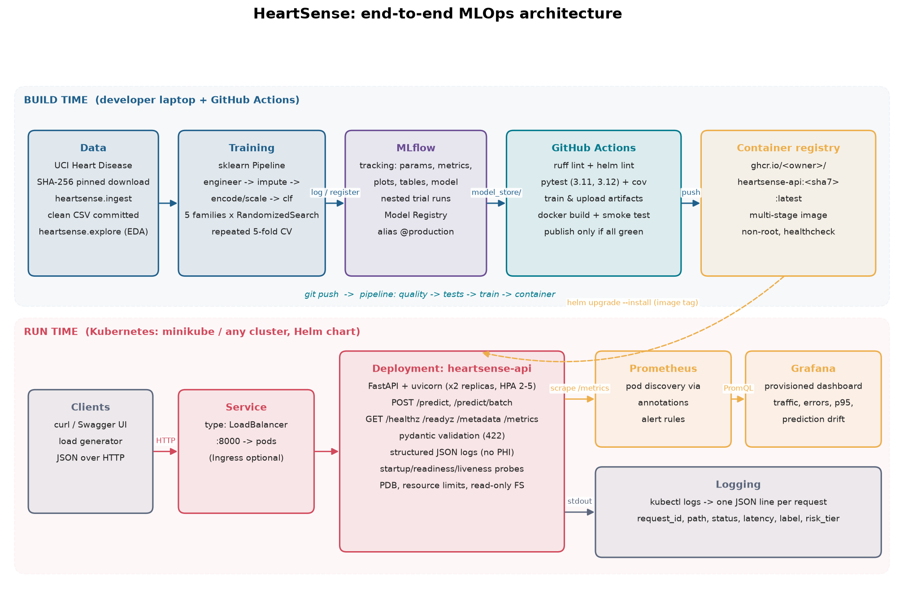

# HeartSense: heart-disease risk prediction with an end-to-end MLOps pipeline

HeartSense predicts the probability that a patient has heart disease from 13 routine clinical
measurements (UCI Heart Disease, Cleveland subset) and serves that prediction as a monitored,
containerised API on Kubernetes. Every stage is code in this repository and runs from a clean
checkout: data acquisition, EDA, training with experiment tracking, tests, CI/CD, container build,
Helm deployment and monitoring.

> BITS Pilani, *Machine Learning Operations (AIMLCZG523)*, Assignment 1. Educational project; not a
> medical device.



## Results

Five model families were tuned with randomised search (24 configurations each, 12 for k-NN) scored
by **repeated stratified 5-fold cross-validation (2 repeats)** on 80 % of the data. The champion is
the family with the best **mean CV ROC-AUC**; the 20 % hold-out set is reported but never used for
selection.

| Model | CV ROC-AUC | CV accuracy | CV recall | Test ROC-AUC | Test accuracy | Test recall | Test precision |
|---|---|---|---|---|---|---|---|
| **Logistic regression** (champion) | **0.917 ± 0.033** | 0.839 | 0.770 | 0.911 | 0.820 | 0.857 | 0.774 |
| SVM (RBF) | 0.915 ± 0.032 | 0.841 | 0.748 | 0.906 | 0.820 | 0.857 | 0.774 |
| Random forest | 0.910 ± 0.033 | 0.818 | 0.771 | 0.921 | 0.836 | 0.857 | 0.800 |
| k-nearest neighbours | 0.900 ± 0.035 | 0.812 | 0.667 | 0.905 | 0.770 | 0.786 | 0.733 |
| Hist. gradient boosting | 0.892 ± 0.042 | 0.816 | 0.789 | 0.916 | 0.869 | 0.893 | 0.833 |

Champion: L2 logistic regression, `C = 0.189`, `lbfgs`, no class weighting, on top of the shared
preprocessing pipeline. Its CV train/validation ROC-AUC gap is the smallest of the five (0.942 vs
0.917), whereas the forest (0.971) and the boosting model (0.979) over-fit the training folds. On the
61-patient hold-out set it misses 4 of 28 diseased patients. Full table: `reports/leaderboard.md`;
plots: `reports/figures/model/`.

## Repository layout

```
src/heartsense/        ML package: settings, ingest, explore (EDA), pipeline, evaluate, train, predict
service/               FastAPI service: app, schemas (pydantic), telemetry (JSON logs + Prometheus)
tests/                 56 pytest tests: ingest, pipeline, training, predict, service
notebooks/             01_exploratory_analysis.ipynb (generated by scripts/build_notebook.py, executed)
data/processed/        cleaned dataset (raw file is downloaded and SHA-256 verified)
model_store/           metadata.json of the exported champion (the .joblib is produced by training)
reports/               eda_profile.json, leaderboard.csv/.md, figures/eda, figures/model
Dockerfile             multi-stage image: python:3.12-slim, non-root, healthcheck
.github/workflows/     mlops-pipeline.yml: quality + helm-lint -> tests (3.11, 3.12) -> train -> container
deploy/helm/           Helm chart: Deployment, Service (LoadBalancer), HPA, PDB, ConfigMap, Ingress (opt.)
deploy/monitoring/     Prometheus (pod discovery, alert rules) + Grafana (provisioned dashboard) manifests
scripts/               minikube_up, deploy, port_forward, smoke_test, load_generator, teardown, publish
docs/                  architecture diagram (+ renderer), VIDEO_SCRIPT.md
report/                written report (docx)
screenshots/           evidence for the report
Makefile               one target per stage (`make help`)
```

## Quick start

Requirements: Python 3.11 or 3.12, Git, Docker (Docker Desktop or colima). Kubernetes (minikube) is
only needed for the deployment step.

```bash
git clone https://github.com/mahamaya-mishra/heartsense-mlops-assignment.git
cd heartsense-mlops-assignment
python3.12 -m venv .venv && source .venv/bin/activate
pip install -r requirements.txt          # also installs the heartsense package (editable)
export MLFLOW_DISABLE_AGENT_HINT=1 PYTHONPATH=src
```

### 1. Data and EDA

```bash
python -m heartsense.ingest              # download, verify SHA-256, clean -> data/processed/
python -m heartsense.explore             # 7 figures -> reports/figures/eda, reports/eda_profile.json
make notebook                            # rebuild + execute notebooks/01_exploratory_analysis.ipynb
```

Source: [UCI Machine Learning Repository, Heart Disease (id 45)](https://archive.ics.uci.edu/dataset/45/heart+disease),
CC BY 4.0. 303 patients, 13 features, 6 missing cells (`?` in `major_vessels` and `thalassemia`),
45.9 % positive.

### 2. Train, track, register

```bash
python -m heartsense.train               # ~1-2 min: 5 families, 108 trials, MLflow, registry, export
python -m heartsense.predict --input examples/patient_high_risk.json
mlflow ui --backend-store-uri sqlite:///mlflow.db --port 5001      # http://127.0.0.1:5001
```

### 3. Lint and tests

```bash
make lint                                # ruff check + ruff format --check
pytest -m "not slow" -q                  # 55 fast tests, ~2 s
pytest --cov                             # + the end-to-end training test, coverage report
```

### 4. Docker

```bash
docker build -t heartsense-api:1.0.0 .                # after training (needs model_store/*.joblib)
docker run -d --rm --name heartsense-api -p 8000:8000 heartsense-api:1.0.0
bash scripts/smoke_test.sh http://127.0.0.1:8000       # readyz, metadata, 2 predictions, batch, 422, metrics
docker rm -f heartsense-api
```

Or use the image CI publishes: `docker run -p 8000:8000 ghcr.io/mahamaya-mishra/heartsense-mlops-assignment:latest`.

### 5. Kubernetes (minikube) with monitoring

```bash
bash scripts/minikube_up.sh                            # profile "heartsense", docker driver, metrics-server
IMAGE=heartsense-api:1.0.0 bash scripts/deploy.sh      # helm upgrade --install + Prometheus + Grafana
bash scripts/port_forward.sh                           # API :8000, Prometheus :9090, Grafana :3000
bash scripts/smoke_test.sh http://127.0.0.1:8000       # through the Kubernetes Service
python scripts/load_generator.py --duration 300 --rps 3   # traffic for the dashboards
```

| Endpoint | URL |
|---|---|
| Swagger UI | http://127.0.0.1:8000/docs |
| Prometheus targets / alerts | http://127.0.0.1:9090/targets, http://127.0.0.1:9090/alerts |
| Grafana dashboard (anonymous viewer) | http://127.0.0.1:3000/d/heartsense-api |

`minikube -p heartsense tunnel` gives the LoadBalancer services real external IPs instead of
port-forwards. Grafana admin password:
`kubectl -n observability get secret grafana-admin -o jsonpath='{.data.admin-password}' | base64 -d`.
Remove everything with `bash scripts/teardown.sh`.

## API

`POST /predict` takes one patient. Field names are descriptive; codes follow the UCI data
dictionary. `major_vessels` and `thalassemia` may be omitted (imputed). Unknown fields and
out-of-range values are rejected with 422.

```bash
curl -s -X POST http://127.0.0.1:8000/predict -H 'Content-Type: application/json' \
     -d @examples/patient_high_risk.json
```

```json
{"prediction": 1, "label": "disease", "risk_score": 0.9512, "confidence": 0.9512, "risk_tier": "high",
 "model_version": "logistic_regression-v1", "request_id": "3f9c1a2b7d4e", "latency_ms": 4.1}
```

| Endpoint | Purpose |
|---|---|
| `POST /predict` | one patient: prediction, probability, confidence, risk tier (low < 0.25 ≤ moderate < 0.5 ≤ elevated < 0.75 ≤ high) |
| `POST /predict/batch` | up to 200 patients |
| `GET /healthz` | liveness |
| `GET /readyz` | readiness (503 until the model is loaded) |
| `GET /metadata` | model card: version, family, hyper-parameters, metrics, dataset hash |
| `GET /metrics` | Prometheus metrics (`heartsense_*`) |
| `GET /docs` | Swagger UI |

## Design decisions

**Data.** The raw file is pinned by SHA-256 so every run trains on byte-identical input. Cleaning is a
pure function: invalid category codes and physiologically implausible readings become NaN, and
duplicates are dropped. Missing values are *not* imputed in the dataset; the model pipeline imputes
them so the statistics come from training folds only.

**Features.** One scikit-learn `Pipeline` does everything: a custom transformer adds three clinical
features (`hr_reserve_pct = max_heart_rate / (220 - age)`, `st_burden = st_depression x slope weight`,
`risk_factor_count`), a `ColumnTransformer` imputes and standardises the numeric columns and one-hot
encodes the nominal ones. The same object is what the API loads, so training and serving cannot drift.

**Model selection.** Randomised search is cheaper than a full grid for the same coverage, and repeating
the 5-fold CV halves the variance of the estimate on 242 training rows. Selection uses CV only;
ties are broken on CV recall because a missed diagnosis is the costlier error.

**Tracking.** MLflow (SQLite backend, local artifact store): one parent run per family with CV and
hold-out metrics, confusion matrix, permutation importance, CV table and the model with a signature;
one nested run per sampled configuration; a `model-selection` run with the leaderboard, ROC, PR and
calibration overlays. The champion is registered as `heartsense-heart-disease` with alias
`production`.

**Serving.** FastAPI with pydantic validation (422 on bad input), readiness separate from liveness,
one JSON log line per request (request id, path, status, latency, label, risk tier; never the patient
payload), Prometheus counters/histograms for requests, latency, predictions by tier, risk-score
distribution and validation errors.

**CI/CD.** `quality` and `helm-lint` run in parallel, then `unit-tests` on Python 3.11 and 3.12,
then `train-model` (uploads model, reports, `mlflow.db`, `mlruns/`), then `container`, which builds
the image, runs it, executes the smoke test and only on `main` pushes `:<sha7>` and `:latest` to GHCR.
Every job uploads logs as artifacts; a failing step stops the chain.

**Deployment.** A Helm chart (two replicas, rolling update with `maxUnavailable: 0`, startup /
readiness / liveness probes, HPA 2-5 on CPU, PDB, non-root read-only container, LoadBalancer
Service, optional Ingress). Prometheus discovers pods through `prometheus.io/*` annotations, so new
replicas are scraped automatically. Grafana is provisioned from files; five alert rules cover model
readiness, 5xx ratio, p95 latency, prediction-rate drift and absence of traffic.

## Reproducibility

* `requirements.txt` (dev) and `requirements-api.txt` (runtime image) are fully pinned.
* `SEED = 2025` for the split, the CV folds and every estimator; `model_store/metadata.json` records the
  dataset hash, git SHA, hyper-parameters, metrics and library versions of the exported model.
* `make` targets wrap every step; the CI workflow is the executable specification of a clean setup.

## Licence

MIT for the code. Dataset: UCI Heart Disease, CC BY 4.0 (Janosi, Steinbrunn, Pfisterer, Detrano, 1988).
